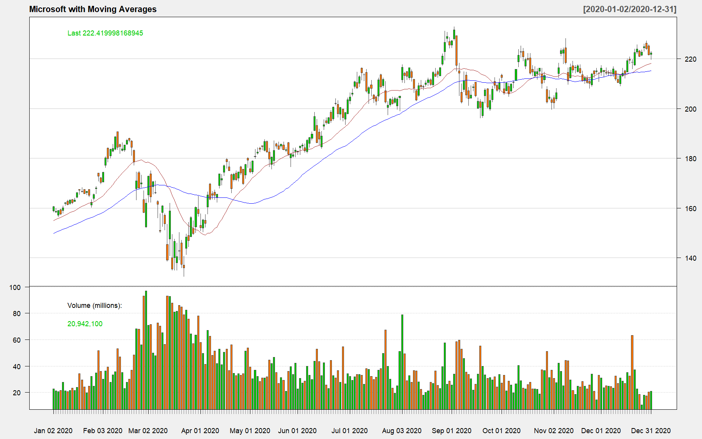
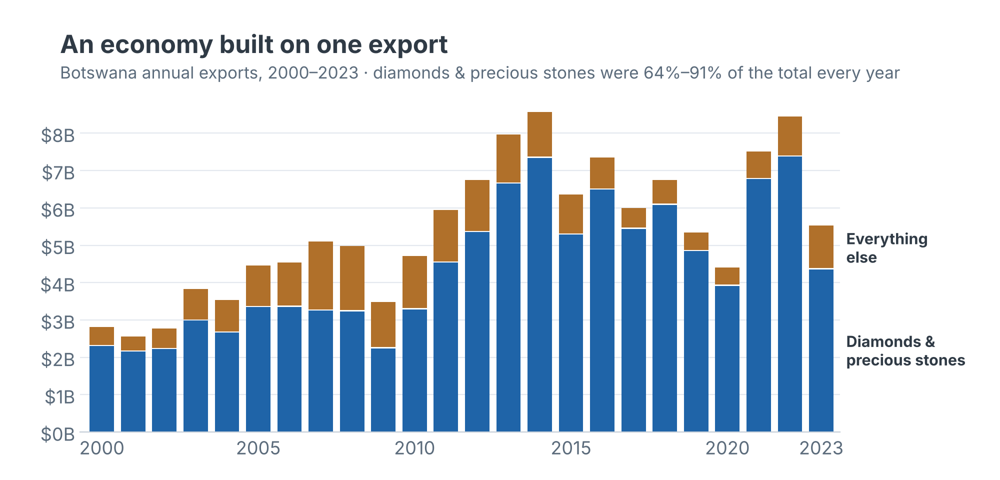
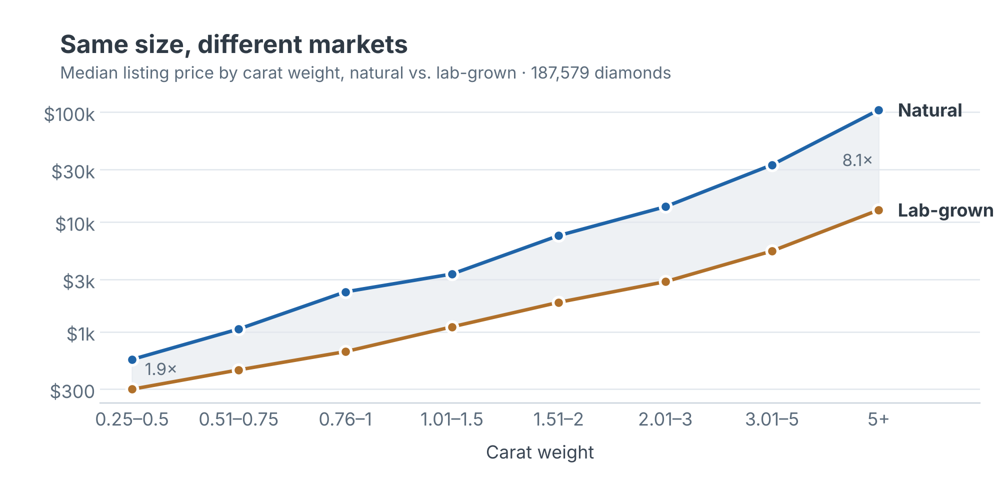

<!-- ABOUT SECTION GOES HERE (tomorrow) -->

<a class="contact-link" href="https://www.linkedin.com/in/boemoseboni/" target="_blank" rel="noopener">LinkedIn</a> <a class="contact-link" href="mailto:boemokseboni@gmail.com">Email</a> <a class="contact-link" href="https://github.com/boemokseboni" target="_blank" rel="noopener">GitHub</a> <a class="contact-link" href="https://public.tableau.com/app/profile/boemo.seboni/vizzes" target="_blank" rel="noopener">Tableau Public</a>
<a class="contact-link" href="Boemo_Seboni_Resume.pdf" target="_blank" rel="noopener">Resume</a>

---

## Education

**Master of Science, Business Intelligence & Analytics** - Saint Joseph's University (May 2027)

**Bachelor of Science, Business Intelligence & Analytics; Machine Learning for Business Applications** - Saint Joseph's University (May 2025)

---

## Skills

Languages & Tools

PythonRSQLSASJMPAlteryxSnowflakeGit & GitHub

Visualization & Reporting

TableauPower BIExcelPowerPoint

Libraries & Packages

pandasNumPyscikit-learnstatsmodelsSciPyTensorFlow/KerasMatplotlibBeautifulSoupdplyrggplot2quantmodcaremmeans

Statistics & Machine Learning

Hypothesis TestingANOVALinear & Logistic RegressionRegression DiagnosticsPCADecision TreesRandom ForestGradient BoostingNeural NetworksSVMLASSOClustering

Forecasting & Validation

Time Series ForecastingExponential SmoothingWalk-Forward BacktestingOut-of-Sample Validation

Data Engineering

API Data CollectionWeb ScrapingPDF & OCR ExtractionSEC EDGAR / XBRLData ValidationETL

Business Analysis

Financial Statement AnalysisCompetitive BenchmarkingKPI ScorecardsPESTLE · SWOT · VRIO

Environments

JupyterVS CodePyCharmSpyderRStudio

---

## Projects

### Academic

#### Stock & Economic Data Analysis with quantmod

A walkthrough of the **quantmod** package, a financial modeling tool for R. The project pulls live data from Yahoo Finance and the Federal Reserve (FRED), then explores and visualizes it:

- Retrieved Microsoft (MSFT) stock prices and the U.S. unemployment rate (2016–2026) using `getSymbols()`
- Explored closing and adjusted prices with summary statistics
- Built candlestick and line charts, adding 20- and 50-day simple moving averages as technical indicators
- Calculated yearly and monthly returns, including a month-by-month breakdown of 2020

**Tools:** R, quantmod, Yahoo Finance API, FRED

<a class="project-link" href="r-quantmod-presentation/Quantmod_Presentation_Seboni.pdf" target="_blank" rel="noopener">📄 Presentation (PDF)</a> <a class="project-link" href="https://github.com/boemokseboni/boemokseboni.github.io/blob/main/r-quantmod-presentation/Quantmod_Presentation_Code_Seboni.R" target="_blank" rel="noopener">💻 R Code</a> <a class="project-link" href="r-quantmod-presentation/Quantmod_Demo_Seboni.mp4" target="_blank" rel="noopener">🎥 Demo Video</a> <a class="project-link" href="r-quantmod-presentation/Quantmod_Presentation_Seboni.pptx">📊 Slides (PowerPoint)</a>

---

#### Forecasting Botswana's Export Diversification Opportunities

Diamonds make up roughly 80% of Botswana's export earnings, and a weakening diamond market has exposed how little the economy is diversified. This project asks which non-diamond export categories show the strongest potential for growth, and how reliably predictive models can identify them.

- Collected 24 years (2000–2023) of Botswana trade data from the UN Comtrade API using Python: 98 product categories, 2,352 product-year observations
- Engineered lag, growth, trend, volatility, and trade-position features, with a chronological train/validation split to prevent data leakage
- Trained and compared eight models in SAS Viya: linear, stepwise, and LASSO regression, decision tree, random forest, gradient boosting, neural network, and SVM (best validation R² = 0.81)
- Tested the forecasts against official Statistics Botswana 2024–2025 figures that the models never saw

**Tools:** Python (pandas, scikit-learn, pdfplumber), SAS Viya, UN Comtrade API

<a class="project-link" href="botswana-export-diversification/Export_Diversification_Paper_Seboni.pdf" target="_blank" rel="noopener">📄 Paper (PDF)</a> <a class="project-link" href="botswana-export-diversification/Export_Diversification_Presentation_Seboni.pdf" target="_blank" rel="noopener">📊 Presentation (PDF)</a> <a class="project-link" href="https://github.com/boemokseboni/boemokseboni.github.io/blob/main/botswana-export-diversification/Export_Diversification_Pipeline_Seboni.ipynb" target="_blank" rel="noopener">💻 Data & Modeling Pipeline</a> <a class="project-link" href="https://github.com/boemokseboni/boemokseboni.github.io/blob/main/botswana-export-diversification/Statistics_Botswana_Validation_Seboni.ipynb" target="_blank" rel="noopener">💻 Forecast Validation</a> <a class="project-link" href="botswana-export-diversification/Export_Diversification_Presentation_Seboni.pptx">📊 Slides (PowerPoint)</a>

*Code developed with AI assistance.*

---

#### Beyond the 4Cs: Provenance, Production Method & Diamond Pricing

Is a diamond's price really just carat, cut, color, and clarity? This project tests whether a diamond's country of origin and production method (natural vs. lab-grown) still affect price once its physical quality is accounted for, a question with real consequences for diamond-dependent economies like Botswana.

- Collected 187,579 diamond listings (94,448 natural, 93,131 lab-grown) across 26 variables using Python
- Applied ANOVA, multiple linear regression, stepwise regression, principal components analysis, and logistic regression in JMP
- Final pricing model explained 90% of price variation (R² = 0.90)
- Found that natural and lab-grown diamonds are effectively two different markets: natural prices lean on color and cut precision, while lab-grown prices lean on clarity

**Tools:** Python (requests, pandas), JMP

<a class="project-link" href="diamond-pricing-analysis/Diamond_Pricing_Report_Seboni.pdf" target="_blank" rel="noopener">📄 Report (PDF)</a> <a class="project-link" href="https://github.com/boemokseboni/boemokseboni.github.io/blob/main/diamond-pricing-analysis/Diamond_Data_Collection_Seboni.ipynb" target="_blank" rel="noopener">💻 Data Collection Notebook</a>

*Code developed with AI assistance.*

<!--
---

### Personal
(coming soon)
-->
